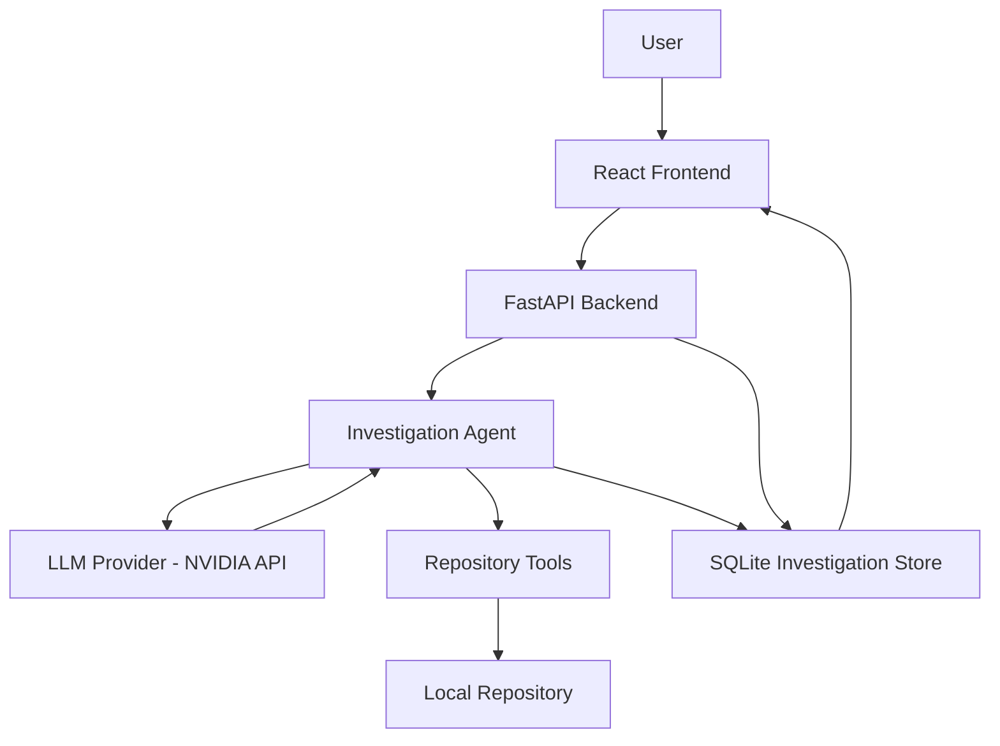

# DevPilot — AI-Powered Bug Investigation Assistant

DevPilot is an agentic AI-powered debugging assistant that investigates reported software bugs by searching and reading repository source code. It uses an LLM-driven investigation loop to identify likely root causes, gather supporting source evidence, and produce actionable debugging reports.

Unlike a general-purpose chatbot, DevPilot grounds its findings in repository files and verified source line numbers. It also maintains investigation history so previous findings can be reviewed.

## Features

- **Agentic bug investigation:** Uses an LLM to plan and perform repository investigations.
- **Repository-aware analysis:** Searches and reads source files from a selected local repository.
- **Evidence-backed reports:** Includes supporting source code, file paths, and line numbers.
- **Root-cause analysis:** Explains the likely cause of a bug and suggests a minimal correction.
- **Investigation history:** Stores investigation reports and evidence in SQLite.
- **Repository management:** Supports registered local repositories.
- **Tool-call validation:** Restricts the agent to approved repository tools and validates their arguments.
- **Path and file protections:** Repository tools enforce path-containment checks and restrictions on sensitive files.
- **Evaluation framework:** Includes benchmark cases, saved baseline reports, and a live evaluation runner.
- **React interface:** Provides a frontend for submitting investigations and reviewing results.

## Architecture



### Investigation workflow

1. The user selects a registered repository and describes a bug.
2. The frontend submits the investigation request to the FastAPI backend.
3. The backend resolves the repository through the repository registry.
4. The agent requests model guidance and invokes approved tools to search or read source files.
5. Tool results are returned to the model as investigation evidence.
6. The agent produces a diagnosis, or marks the investigation incomplete if it cannot reach a conclusion within its iteration limit.
7. The backend stores the result and makes it available through the API and investigation history.

The agent does not execute tests or modify repository files. Its recommendations are based on the source evidence returned by its tools.

## Technology stack

| Component | Technology |
|---|---|
| Frontend | React 19, Vite 8 |
| Markdown rendering | React Markdown, remark-gfm |
| Backend | Python, FastAPI |
| LLM integration | OpenAI-compatible SDK, NVIDIA API endpoint |
| Repository analysis | Python search and file-reading tools |
| Data persistence | SQLite |
| Testing | pytest |
| Evaluation | Custom benchmark cases and scoring scripts |

## Project structure

```text
DevPilot/
├── evaluation/
│   ├── cases.json
│   ├── baseline.json
│   ├── scorer.py
│   ├── run_baseline.py
│   └── run_live.py
├── frontend/
│   ├── package.json
│   └── ... frontend source files
├── src/
│   └── devpilot/
│       ├── api.py
│       ├── agent.py
│       ├── tools.py
│       ├── repository_registry.py
│       └── ... supporting backend modules
├── tests/
├── test_fixtures/
├── setup_boundary_repository.py
├── setup_data_flow_repository.py
├── setup_test_repository.py
├── requirements.txt
├── .env
├── .gitignore
└── README.md
```

The investigation database is maintained under `src/devpilot/data/`.

## Prerequisites

- Python 3.11 or a compatible Python version
- Node.js and npm
- An NVIDIA API key with access to the configured model
- Git, if you intend to clone the repository

The project has been developed and tested in a Windows PowerShell environment.

## Installation

### 1. Clone or open the project

```powershell
cd C:\Users\ayush\DevPilot
```

If cloning from a remote Git repository, use your repository URL and then enter the project directory.

### 2. Create and activate the Python environment

```powershell
python -m venv .venv
.\.venv\Scripts\Activate.ps1
```

If PowerShell blocks environment activation, use an approved activation method for your machine or run the environment's Python executable directly.

### 3. Install backend dependencies

The root `requirements.txt` should contain the project's complete pinned Python dependencies before a fresh installation is considered reproducible.

For the current development environment, install the core packages with:

```powershell
python -m pip install fastapi "uvicorn[standard]" openai python-dotenv pytest
```

Additional dependencies may be required by supporting modules or tests. Once the dependency list is finalized, use:

```powershell
python -m pip install -r requirements.txt
```

### 4. Configure environment variables

Create a `.env` file in the project root:

```dotenv
NVIDIA_API_KEY=your_nvidia_api_key
NVIDIA_MODEL=nvidia/nemotron-3.5-super-vl-120b-a12b
```

Replace the placeholder with your own API key. Never commit API keys or other credentials to version control.

The agent reads these variables when its module is initialized. Restart the backend after changing them.

### 5. Install frontend dependencies

```powershell
cd frontend
npm install
cd ..
```

## Running DevPilot

Start the backend and frontend in separate PowerShell terminals.

### Terminal 1: Backend

From the project root, with the virtual environment activated:

```powershell
uvicorn api:app --app-dir src/devpilot --reload
```

The API should be available at:

- API base URL: `http://127.0.0.1:8000`
- Health endpoint: `http://127.0.0.1:8000/api/health`
- Registered repositories: `http://127.0.0.1:8000/api/repositories`
- API documentation: `http://127.0.0.1:8000/docs`

### Terminal 2: Frontend

```powershell
cd C:\Users\ayush\DevPilot\frontend
npm run dev
```

Open the local URL printed by Vite, normally:

`http://localhost:5173`

## Using DevPilot

1. Start the backend and frontend.
2. Open the frontend in your browser.
3. Connect to or select a registered local repository.
4. Describe the bug, including the affected function, observed behavior, and expected behavior when known.
5. Submit the investigation.
6. Review the root-cause explanation, source evidence, suggested correction, and investigation status.
7. Open investigation history to review previous reports.

### Example investigation

Consider this function:

```python
def calculate_total(numbers):
    total = 0
    for i in range(len(numbers) - 1):
        total += numbers[i]
    return total
```

For the input `[100, 200, 300]`, the loop skips the final element and returns `300` instead of `600`.

A useful investigation request is:

> Investigate why `calculate_total` returns an incorrect total. Identify the exact root cause, cite verified source file paths and line numbers, and suggest the minimal correction. Do not modify any files.

DevPilot should identify the off-by-one error, explain the skipped element, and recommend correcting the loop boundary.

## API endpoints

| Method | Endpoint | Purpose |
|---|---|---|
| GET | `/api/health` | Check backend health |
| GET | `/api/repositories` | List registered repositories |
| POST | `/api/investigations` | Start a new investigation |
| GET | `/api/investigations` | Retrieve investigation history |
| GET | `/api/investigations/{id}` | Retrieve a specific investigation |

Interactive API documentation is available at `/docs` while the backend is running.

## Testing

Run the automated test suite from the project root:

```powershell
pytest -q
```

The latest recorded test result during development was:

```text
61 passed, 1 skipped
```

This is a historical development result, not a guarantee that every environment or future revision will produce the same result.

## Evaluation

DevPilot includes benchmark cases for known bug scenarios, saved baseline reports, a scorer, and a live evaluation runner.

### Evaluate saved baseline reports

```powershell
python evaluation\run_baseline.py
```

The baseline evaluation previously achieved:

```text
Cases passed: 3/3
```

The scorer uses keyword and evidence matching, alongside additional root-cause checks for supported cases. These metrics are useful for regression testing, but they do not establish semantic correctness in every possible investigation.

### Run live evaluation

Start the backend first, then run:

```powershell
python evaluation\run_live.py
```

Live evaluation calls the configured model API and may consume API credits. It can also fail because of provider errors, network issues, timeouts, or model behavior. Saved baseline evaluation is preferable for routine regression checks.

## Security and reliability

- Repository access is resolved through the repository registry.
- The agent is restricted to approved search and file-reading tools.
- Tool arguments are validated before execution.
- Repository tools enforce path-containment checks and restrictions on sensitive files.
- Source line numbers are taken from tool output rather than inferred by counting lines in a generated report.
- Provider errors and incomplete investigations are handled separately from successful diagnoses.
- API credentials must remain in environment configuration and must not be committed to source control.

These controls reduce risk but should not be treated as a substitute for a complete security audit.

## Current limitations

- **Local repositories:** The current investigation agent supports registered local repositories; GitHub repositories require a separate integration.
- **No automatic code changes:** The agent reads and analyzes source code but does not modify files or execute tests.
- **Model dependency:** Investigations depend on the configured NVIDIA model API and network availability.
- **Bounded investigations:** An investigation may be marked incomplete if the model does not produce a conclusion within the iteration limit.
- **Heuristic evaluation:** Benchmark scores are approximations of investigation quality and do not replace manual review.
- **Dependency reproducibility:** The root Python dependency manifest needs to be populated and maintained for reliable fresh-environment installation.

## Future improvements

- Improve investigation planning and reduce irrelevant tool calls.
- Expand the benchmark with more bug categories and regression cases.
- Improve evaluation of semantic correctness and evidence relevance.
- Add automated test execution in a controlled sandbox.
- Add Git-based and remote repository integrations.
- Improve provider retry handling and observability.
- Add optional, user-approved code patches and test generation.
- Strengthen dependency management, CI, and deployment documentation.

## License

Add the project's chosen license before publishing or distributing the repository. Until a license is specified, do not assume that others have permission to reuse or redistribute the code.

---

**DevPilot** — Evidence-backed bug investigation, powered by agentic AI.
