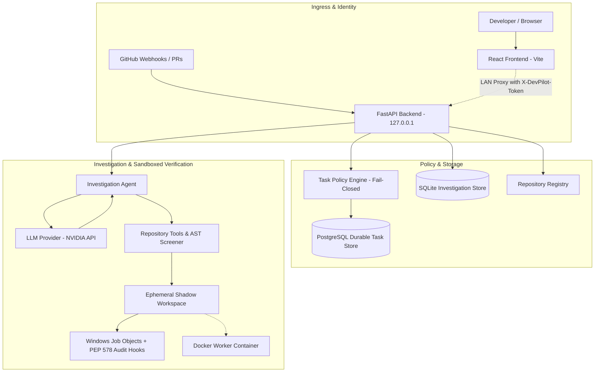

# DevPilot — AI-Powered Bug Investigation Assistant

DevPilot is an agentic AI-powered debugging assistant that investigates reported software bugs by searching and reading repository source code. It uses an LLM-driven investigation loop to identify likely root causes, gather supporting source evidence, and produce actionable debugging reports.

Unlike a general-purpose chatbot, DevPilot grounds its findings in repository files and verified source line numbers. It also maintains investigation history so previous findings can be reviewed.

## Features

- **Agentic bug investigation:** Uses an LLM to plan and perform repository investigations.
- **Repository-aware analysis:** Searches and reads source files from a selected local or cloned repository.
- **Evidence-backed reports:** Includes supporting source code, file paths, and line numbers.
- **Root-cause analysis:** Explains the likely cause of a bug and suggests a minimal correction.
- **Investigation history:** Stores investigation reports and evidence in SQLite.
- **Repository management:** Supports registered local repositories and public GitHub clones.
- **Tool-call validation & AST defense:** Restricts the agent to approved tools, validates arguments, and screens tests with an AST defense engine.
- **Path and file protections:** Repository tools enforce path-containment checks and restrictions on sensitive files.
- **Empirical sandbox verification:** Executes reproduction tests and shadow patches under Windows Job Object limits and PEP 578 runtime audit hooks.
- **Strict verification semantics:** Differentiates `fully_verified`, `regression_failed`, `regression_suite_missing`, and `reproduction_failed` without claiming false fixes.
- **Self-hosted production foundation:** Includes a durable PostgreSQL task store, locked state machine (`queued` through `awaiting_approval`), and immutable audit logging.
- **Read-only GitHub App ingress:** Authenticates GitHub Apps via short-lived JWTs, verifies HMAC SHA-256 webhook signatures, deduplicates deliveries, and preserves repo read-only safety.
- **Fail-closed policy engine:** Separates untrusted issue/PR text from authorization; explicitly blocks writes, commits, merges, and deployments.
- **Docker containerization:** Provides a pinned PostgreSQL service and a dedicated worker image (`Dockerfile.worker`, `compose.yaml`) for containerized Linux validation.
- **React interface & LAN support:** Features a Vite/React dashboard with token-protected LAN proxying for mobile review on trusted networks.
- **Real-world library validation:** Evaluated against complex real-world open-source repositories (`psf/requests` and `encode/httpx`).

## Architecture



### Investigation workflow

1. The user selects a registered repository and describes a bug (or a signed GitHub webhook delivers a pull-request event).
2. The request enters the backend, where task policy validates permissions and boundaries outside the LLM.
3. The repository is resolved through the trusted local registry or cloned safely into an isolated local checkout.
4. The agent requests model guidance and invokes approved tools to search or read source files.
5. Tool results and AST-screened file snippets are returned to the model as investigation evidence.
6. When a concrete bug is identified, the agent synthesizes a minimal reproduction script and invokes `run_reproduction_test` in an isolated shadow workspace.
7. The agent proposes a minimal patch and tests it via `validate_patch` in the shadow workspace, producing a unified diff and checking for regressions in preexisting suites.
8. The backend stores the report, verification metadata, diff, and audit events, displaying verification badges ("Verified with Test", "Regression Failed", etc.) in the UI.

The agent never modifies repository files on the host; all execution and patching occur strictly within ephemeral shadow copies.

## Technology stack

| Component | Technology |
|---|---|
| Frontend | React 19, Vite 8, React Markdown, remark-gfm |
| Backend | Python 3.11+, FastAPI, Uvicorn, Pydantic |
| LLM integration | OpenAI-compatible SDK, NVIDIA API endpoint |
| Sandbox isolation | Windows Job Objects, PEP 578 Python runtime audit hooks |
| Containerized workers | Docker, Docker Compose, Alpine Linux |
| Data persistence | SQLite (local investigations), PostgreSQL (durable tasks & webhooks) |
| GitHub App auth | PyJWT, Cryptography (RS256 JWT, HMAC-SHA256 webhooks) |
| Testing & Evaluation | pytest, custom multi-trial benchmark runner, baseline scorer |

## Project structure

```text
DevPilot/
├── compose.yaml                      # Pinned PostgreSQL service for task/audit records
├── Dockerfile.worker                 # Isolated container image for sandboxed validation
├── docs/                             # Architecture and operational runbooks
│   ├── DOCKER_SELF_HOSTED_SETUP.md
│   ├── GITHUB_APP_READ_ONLY_SETUP.md
│   └── SELF_HOSTED_PRODUCTION_FOUNDATION.md
├── evaluation/
│   ├── cases.json                    # Benchmark case catalog (8 fixtures)
│   ├── baseline.json                 # Pre-recorded baseline investigation reports
│   ├── baseline_results.json         # Evaluated metrics from baseline runs
│   ├── engine_results.json           # 5-trial empirical sandbox execution data
│   ├── httpx_investigation_result.json # Real-world HTTPX #3621 investigation artifact
│   ├── requests_investigation_result.json # Real-world Requests #6711 investigation artifact
│   ├── run_engine_benchmark.py       # Multi-trial engine benchmark runner
│   ├── run_baseline.py               # Offline baseline evaluator
│   ├── run_live.py                   # Live LLM investigation benchmark runner
│   ├── scorer.py                     # Independent multi-dimensional scoring engine
│   └── BENCHMARK.md                  # Comprehensive benchmark specification
├── frontend/
│   ├── package.json
│   ├── vite.config.js                # Trusted LAN proxy and backend token injector
│   └── src/                          # React UI components and stylesheets
├── src/
│   └── devpilot/
│       ├── agent.py                  # Agentic investigation loop & tool caller
│       ├── api.py                    # FastAPI application & REST endpoints
│       ├── evidence_safety.py        # Evidence sanitization and redaction
│       ├── github_app_auth.py        # GitHub App RS256 JWT & installation tokens
│       ├── github_app_config.py      # App credential path & ID validation
│       ├── github_webhook.py         # Webhook ingress & HMAC signature verification
│       ├── isolated_checkout.py      # Safe git checkout manager
│       ├── production_config.py      # Typed production environment validator
│       ├── repository_registry.py    # Local & public GitHub repo registry
│       ├── sandbox.py                # Shadow workspaces & Windows Job Objects
│       ├── sandbox_runner.py         # Subprocess runner with PEP 578 audit hooks
│       ├── task_orchestrator.py      # Lifecycle state machine orchestrator
│       ├── task_policy.py            # Fail-closed repository capability policy
│       ├── task_store.py             # PostgreSQL durable task state & audit log
│       ├── tools.py                  # Approved inspection and verification tools
│       └── webhook_service.py        # Webhook payload parsing & queue ingress
├── test_fixtures/                    # Minimal reproduction fixture repositories
├── tests/                            # Comprehensive automated pytest suite (156 tests)
├── requirements.txt                  # Pinned backend dependencies
├── .env.example                      # Documented configuration template
├── .gitignore
└── README.md
```

The investigation database is maintained under `src/devpilot/data/`.

## Prerequisites

- Python 3.11 or a compatible Python version
- Node.js and npm
- An NVIDIA API key with access to the configured model
- Git, if you intend to clone the repository

The project has been developed and tested in a Windows PowerShell environment.

## Installation

### 1. Clone or open the project

```powershell
cd C:\Users\ayush\DevPilot
```

If cloning from a remote Git repository, use your repository URL and then enter the project directory.

### 2. Create and activate the Python environment

```powershell
python -m venv .venv
.\.venv\Scripts\Activate.ps1
```

If PowerShell blocks environment activation, use an approved activation method for your machine or run the environment's Python executable directly.

### 3. Install backend dependencies

The root `requirements.txt` should contain the project's complete pinned Python dependencies before a fresh installation is considered reproducible.

For the current development environment, install the core packages with:

```powershell
python -m pip install fastapi "uvicorn[standard]" openai python-dotenv pytest
```

Additional dependencies may be required by supporting modules or tests. Once the dependency list is finalized, use:

```powershell
python -m pip install -r requirements.txt
```

### 4. Configure environment variables

Create a `.env` file in the project root:

```dotenv
NVIDIA_API_KEY=your_nvidia_api_key
NVIDIA_MODEL=nvidia/nemotron-3.5-super-vl-120b-a12b
```

Replace the placeholder with your own API key. Never commit API keys or other credentials to version control.

The agent reads these variables when its module is initialized. Restart the backend after changing them.

### 5. Install frontend dependencies

```powershell
cd frontend
npm install
cd ..
```

## Running DevPilot

Start the backend and frontend in separate PowerShell terminals.

### Terminal 1: Backend

From the project root, with the virtual environment activated:

```powershell
uvicorn api:app --app-dir src/devpilot --reload
```

The API should be available at:

- API base URL: `http://127.0.0.1:8000`
- Health endpoint: `http://127.0.0.1:8000/api/health`
- Registered repositories: `http://127.0.0.1:8000/api/repositories`
- API documentation: `http://127.0.0.1:8000/docs`

### Terminal 2: Frontend

```powershell
cd C:\Users\ayush\DevPilot\frontend
npm run dev
```

Open the local URL printed by Vite, normally:

`http://localhost:5173`

### Optional: use DevPilot from a phone on a trusted local network

DevPilot is loopback-only by default. To use the frontend from a phone on the
same private Wi-Fi network, keep the backend bound to `127.0.0.1` and add these
values to the project-root `.env` file:

```dotenv
DEVPILOT_LAN_ENABLED=true
DEVPILOT_API_TOKEN=replace-with-a-long-random-secret
```

Restart both servers, then open the Network URL printed by Vite on the phone.
The Vite development server proxies `/api` calls to the loopback backend and
adds the token server-side; the token is not included in browser JavaScript.

This is for a **trusted private network only**. The Vite development server has
no per-user login, so any device that can reach its Network URL can operate the
DevPilot interface. Do not expose it to the public internet, port-forward it,
or use it on untrusted Wi-Fi. Windows may ask to allow Vite through the Private
network firewall profile; do not enable Public-network access.

### Importing public GitHub repositories

The **Repositories** page can import a public `https://github.com/owner/repository`
URL. DevPilot clones it into `src/devpilot/data/repositories/` and investigates
that local checkout. It rejects URLs containing credentials and does not store a
GitHub token, push changes, create branches, or open pull requests.

For empirical Python validation, create a project-local `.venv` and install the
repository's documented test dependencies yourself, then refresh DevPilot. It
automatically uses `.venv\Scripts\python.exe` (or `.venv/bin/python`) when
present. DevPilot deliberately does not run arbitrary setup scripts or install
unreviewed dependencies automatically. Source inspection supports several
common code formats, but sandboxed execution and patch verification currently
support Python only.

## Using DevPilot

1. Start the backend and frontend.
2. Open the frontend in your browser.
3. Connect to or select a registered local repository.
4. Describe the bug, including the affected function, observed behavior, and expected behavior when known.
5. Submit the investigation.
6. Review the root-cause explanation, source evidence, suggested correction, and investigation status.
7. Open investigation history to review previous reports.

### Example investigation

Consider this function:

```python
def calculate_total(numbers):
    total = 0
    for i in range(len(numbers) - 1):
        total += numbers[i]
    return total
```

For the input `[100, 200, 300]`, the loop skips the final element and returns `300` instead of `600`.

A useful investigation request is:

> Investigate why `calculate_total` returns an incorrect total. Identify the exact root cause, cite verified source file paths and line numbers, and suggest the minimal correction. Do not modify any files.

DevPilot should identify the off-by-one error, explain the skipped element, and recommend correcting the loop boundary.

## API endpoints

| Method | Endpoint | Purpose | Auth |
|---|---|---|---|
| GET | `/api/health` | Check backend health | Public |
| GET | `/api/repositories` | List registered repositories | Token (opt-in / LAN) |
| POST | `/api/repositories/github-public` | Clone and register a public GitHub repository | Token (opt-in / LAN) |
| POST | `/api/investigations` | Start a new synchronous investigation | Token (opt-in / LAN) |
| GET | `/api/investigations` | Retrieve investigation history | Token (opt-in / LAN) |
| GET | `/api/investigations/{id}` | Retrieve a specific investigation and evidence | Token (opt-in / LAN) |
| POST | `/api/github/webhooks` | Ingress pull-request webhook into durable queue | HMAC SHA-256 |
| GET | `/api/tasks/{task_id}` | Retrieve durable task state and audit events | Token (opt-in / LAN) |
| POST | `/api/tasks/{task_id}/process` | Advance durable task through its lifecycle | Token (opt-in / LAN) |

When `DEVPILOT_API_TOKEN` is configured or LAN mode is active, endpoints requiring authorization expect an `X-DevPilot-Token` header. The Vite frontend proxy attaches this server-side when running with LAN mode enabled.

Interactive API documentation is available at `/docs` while the backend is running.

## Testing

Run the automated test suite from the project root:

```powershell
.\.venv\Scripts\pytest.exe -q
```

The latest recorded test result across the full production foundation, security, evaluation, and sandbox suites:

```text
153 passed, 3 skipped in 10.25s
```

All 156 test items evaluate repository registry bounds, token authentication, GitHub App RS256 JWT minting, webhook signature enforcement, isolated checkouts, task state transitions, TaskOrchestrator lifecycle transitions, Job Object quotas, and PEP 578 runtime audit traps.

## Evaluation

DevPilot includes an expanded 8-case benchmark taxonomy, an empirical engine benchmark runner, saved baseline reports, a multi-dimensional scorer, live evaluation runners, and real-world open-source case studies.

The benchmark spans 6 core categories:
1. **Reliable Bug Reproduction:** `empty-list-division`, `normalized-username-lookup`, `off-by-one-total`
2. **False Positive Rejection:** `non-reproducible-bogus`
3. **Regression Detection:** `flawed-patch-regression`
4. **Dependency / Setup Failure:** `missing-dependency`
5. **Timeout Enforcement:** `runaway-infinite-loop`
6. **Ambiguous API Contracts:** `ambiguous-contract-empty`

### Real-world open-source empirical case studies

In addition to synthetic fixture repositories, DevPilot's agentic loop and verification engine were evaluated against real-world open-source libraries:

#### 1. PSF Requests Issue #6711 (`evaluation/requests_investigation_result.json`)
- **Bug Context:** In `psf/requests`, constructing URLs with double leading slashes in the path (e.g., `http://127.0.0.1:10000//v:h`) causes `HTTPAdapter.request_url` (`src/requests/adapters.py:592-594`) to strip the leading slashes down to a single slash (`/v:h`).
- **Empirical Sandbox Reproduction:** DevPilot pinpointed `src/requests/adapters.py:593` and generated a minimal reproduction test that confirmed the defect with `AssertionError: assert '/v:h' == '//v:h'` (exit code 1).
- **Shadow Patch & Strict Regression Detection:** Applying the candidate patch resolved the minimal reproduction test cleanly. However, executing Requests' existing regression test suite in the shadow workspace revealed that `test_request_url_trims_leading_path_separators` in `tests/test_adapters.py:8` explicitly asserted the legacy trimming behavior.
- **Outcome:** DevPilot correctly reported `verification_status: regression_failed` (`reproduction_resolved: True`, `fix_verified: False`, `regression_suite_passed: False`), proving that DevPilot rejects flawed candidate patches that break preexisting test suites in large codebases.

#### 2. Encode HTTPX Issue #3621 (`evaluation/httpx_investigation_result.json`)
- **Bug Context:** Investigated query parameter merging behavior when providing additional parameters via `params=`.
- **AST Screener & Confinement:** Demonstrated the AST defense screener validating module import boundaries and identifying dependency requirements within isolated Python execution environments.

### Run empirical engine benchmark

The empirical engine benchmark exercises the actual reproduction and patch validation engine in shadow sandboxes across all 8 cases. You can execute multiple repeated trials to measure consistency and latency distributions:

```powershell
python evaluation\run_engine_benchmark.py --trials 5
```

It outputs live demonstrated outcomes and per-case latency statistics:

```text
======================================================================
EMPIRICAL BENCHMARK SUMMARY (ACROSS ALL REPEATED TRIALS):
  Total Benchmark Cases:        8
  Analysis Quality Pass Rate:   8/8 (100%)
  Reproduction Confirmed:       5/8 (62%)
  Reproduction Resolved:        4/8
  Fix Verified Cleanly:         3/8 (38%)
  Regressions Caught:           1
  False Positives Rejected:     1
  Timeouts Enforced:            1
  Dependencies Classified:      1
======================================================================
```

For the complete benchmark specification, full 8-fixture catalog, runtime configurations, scoring definitions, and 5-trial latency distributions (min, mean, max, p95), see [evaluation/BENCHMARK.md](evaluation/BENCHMARK.md).

### Evaluate saved baseline reports

```powershell
python evaluation\run_baseline.py
```

The baseline evaluation outputs an unambiguous, multi-dimensional metric breakdown:

```text
=================================================================
INDEPENDENT METRIC SUMMARY:
  Total Cases:                  8
  Analysis Quality Pass Rate:   8/8 (100%)
  Reproduction Confirmed Rate:  0/8 (0%)
  Fix Verification Rate:        0/8 (0%)
  Regressions Caught:           0
  False Positives Rejected:     1
  Timeouts Enforced:            0
  Dependencies Classified:      0
=================================================================
Note: Explanation quality and empirical sandbox verification are reported independently.
```

The scorer strictly distinguishes explanation quality (keyword and verified evidence grounding) from empirical sandbox verification, ensuring that offline analysis never implies that bugs were empirically verified.

### Run live evaluation

Start the backend first, then run:

```powershell
python evaluation\run_live.py
```

Live evaluation calls the configured model API and measures each verification metric independently. It can also fail because of provider errors, network issues, timeouts, or model behavior. Saved baseline evaluation is preferable for routine regression checks.

## Security and sandbox boundaries

Execution uses a defense-in-depth runtime policy with Windows resource limits:

1. **Windows Job Object Resource Limits:**
   - Subprocesses are assigned to Windows Job Objects (`JOB_OBJECT_LIMIT_KILL_ON_JOB_CLOSE = 0x2000`) guaranteeing process tree termination on exit.
   - Enforced 256MB memory caps and max 5 active processes to prevent fork-bombs and memory exhaustion.
   - Validation fails closed when the Job Object cannot be configured or assigned. This project does **not** currently create Low Integrity or restricted Windows tokens.

2. **Python Runtime Audit Hooks (PEP 578 via `sandbox_runner.py`):**
   - Enforces socket network denial (`socket.connect`, `socket.bind`, `socket.sendto`, `socket.getaddrinfo`).
   - Filesystem confinement allows reads only from the ephemeral `shadow_root` and selected Python runtime roots; it prevents writes outside the shadow workspace.
   - Intercepts subprocess spawning and dynamic C library (`ctypes`) loading.

3. **Strict Verification Semantics:**
   - `reproduction_resolved`: Minimal reproduction test passes against the shadow patch.
   - `regression_suite_passed`: Preexisting regression tests pass without error.
   - `fix_verified`: Strictly requires `reproduction_confirmed AND reproduction_resolved AND regression_suite_passed is True`.
   - If no regression suite is available, a resolved reproduction is reported as `regression_suite_missing`, never as a verified fix. If a patch breaks the suite, the status is `regression_failed`.

These controls provide defense-in-depth during local development, but userland audit hooks and Job Objects do not replace a full VM/hypervisor or container boundary against adversarial native code exploits. A dedicated external security review of token lifecycle, ACLs, and process isolation is required before accepting untrusted repositories.

## Current limitations

- **GitHub scope:** Public HTTPS repositories can be cloned locally. Private repositories, GitHub OAuth, credential storage, pushes, branches, and pull requests are not implemented.
- **Execution languages:** Source inspection handles common code formats, while empirical reproduction, regression testing, and patch verification currently support Python projects only.
- **Dependencies:** DevPilot never executes project setup/install scripts automatically. A project must provide a user-created compatible virtual environment for dependency-aware validation.
- **Host repository immutability:** The agent validates patches in shadow workspaces and displays unified diffs with test verification, but does not mutate the developer's original files.
- **Model dependency:** Investigations depend on the configured NVIDIA model API and network availability.
- **Bounded investigations:** An investigation may be marked incomplete if the model does not produce a conclusion within the iteration limit.
- **Contract ambiguity:** For edge cases like empty inputs, multiple valid API behaviors exist (e.g. returning 0 vs raising ValueError vs returning None); the engine identifies and highlights these contract trade-offs.

## Self-hosted production roadmap

DevPilot is currently a local investigation application, not an Internet-facing
production automation service. The production foundation and its locked safety
boundaries are documented in [SELF_HOSTED_PRODUCTION_FOUNDATION.md](docs/SELF_HOSTED_PRODUCTION_FOUNDATION.md).
The first GitHub App milestone is read-only and requires explicit installation
on a selected repository; it cannot create branches, PRs, merges, or deployments.
For the local Docker Desktop PostgreSQL prerequisite, use
[DOCKER_SELF_HOSTED_SETUP.md](docs/DOCKER_SELF_HOSTED_SETUP.md).

## Future improvements

- Improve investigation planning and reduce irrelevant tool calls.
- Expand the benchmark with more bug categories and regression cases.
- Improve evaluation of semantic correctness and evidence relevance.
- Add automated test execution in a controlled sandbox.
- Add Git-based and remote repository integrations.
- Improve provider retry handling and observability.
- Add optional, user-approved code patches and test generation.
- Strengthen dependency management, CI, and deployment documentation.

## License

Add the project's chosen license before publishing or distributing the repository. Until a license is specified, do not assume that others have permission to reuse or redistribute the code.

---

**DevPilot** — Evidence-backed bug investigation, powered by agentic AI.
